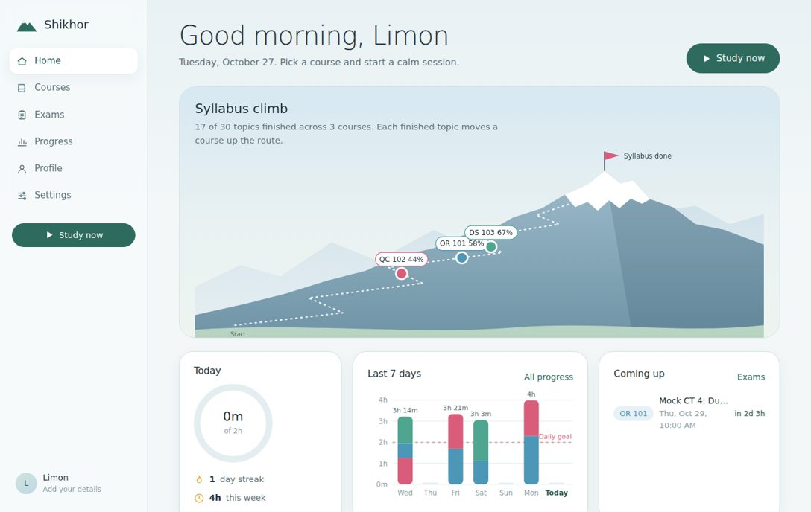
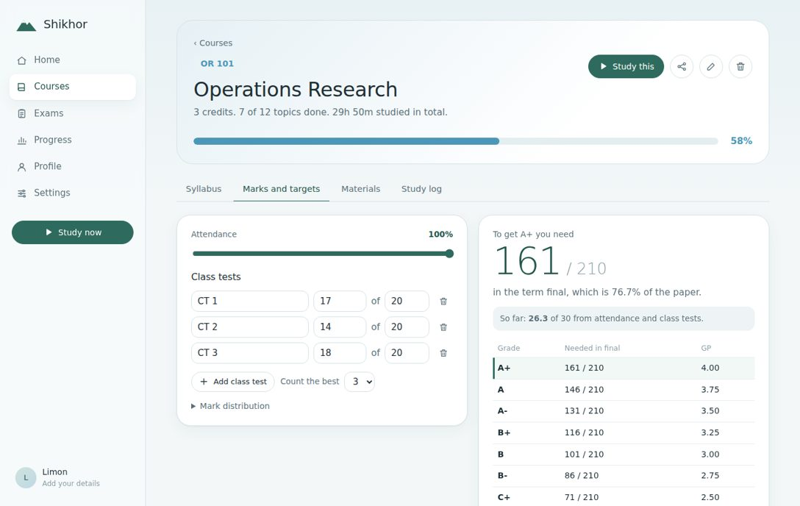
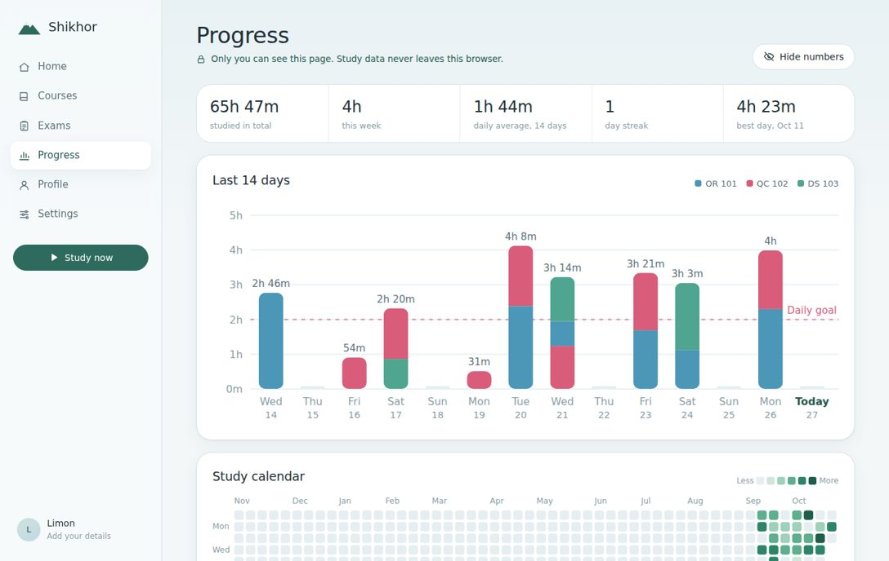
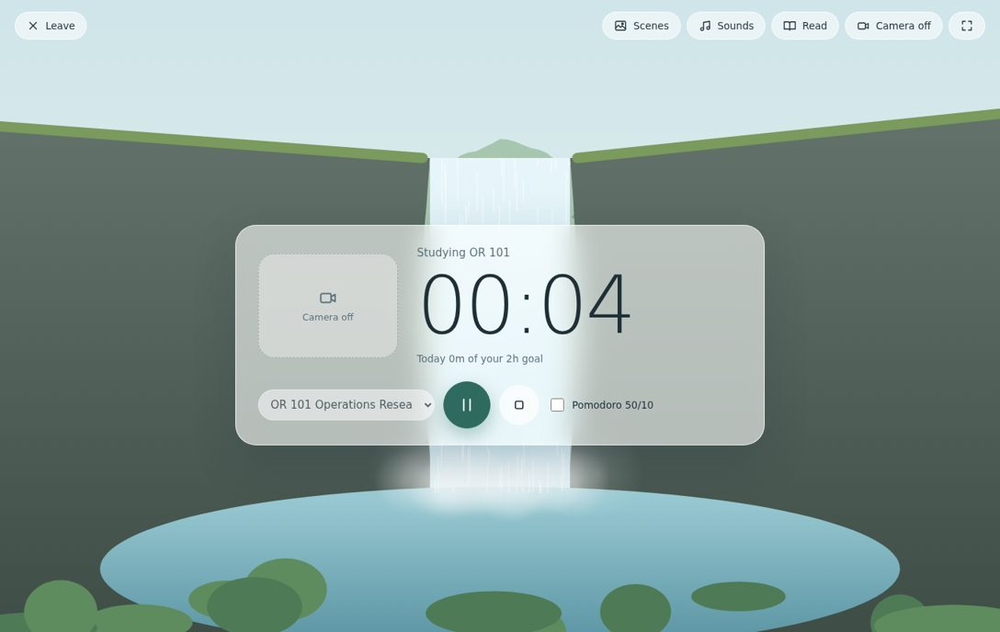

# Shikhor (শিখর)

**A calm study space for students.** Track your syllabus as a mountain climb, time your study inside animated nature scenes with soft ambient sound, see exactly how many marks you need in the term final for an A+, and sit mock exams with your camera on and a clock running.

Free, open source, no sign-up, no server. Everything is saved in your own browser.



## What it does

| | |
|---|---|
| **Syllabus climb** | Add topics (or paste a whole syllabus). Each finished topic moves the course up a mountain route on your home page. |
| **Focus room** | Full-screen timer with your camera beside it, 10 animated scenes (Himalayan dawn, Everest at night, monsoon rain, snowfall, waterfall, sunset lake, firefly forest, northern lights, spring blossoms, Bay of Bengal) and 10 mixable sounds generated live. Pomodoro mode and a built-in reader for your PDFs. |
| **Marks and targets** | Enter attendance and class tests. Shikhor shows the marks you need in the final for every grade, with a "what if" slider. Uses the BUET scale and 10/20/70 split by default; both are editable. |
| **Mock exams** | Schedule an exam with multiple-choice and written questions. When the time comes, the exam room opens by itself, turns on the camera and starts the countdown. Leaving the tab is recorded. MCQs are marked automatically; you mark written answers yourself. |
| **Private progress** | Bar charts, a year-long study calendar, a weekday-by-hour heatmap, a grade and CGPA forecast. Lock them with a PIN or blur the numbers. |
| **Materials** | Upload files to the browser, add links, or connect the `materials/` folder of your GitHub repository. |
| **Sharing** | Send a link that lets a friend copy your courses, syllabus, marks and material links into their own Shikhor. Study time and exams are never shared. |
| **Profiles** | Photo, details, daily goal and target grade. Several people can keep separate profiles on one laptop. |





## Put it online with GitHub Pages (free)

You need a free GitHub account. No coding or installing is required.

1. **Create the repository.** On github.com click **New**, name it `shikhor`, choose **Public**, and click **Create repository**.
2. **Upload the files.** On the new repository page click **uploading an existing file**. Drag in everything from this folder: `index.html`, `css`, `js`, `materials`, `docs`, `README.md`, `LICENSE`. Click **Commit changes**.
   (`.nojekyll` is a hidden file and may not drag across. That is fine.)
3. **Turn on Pages.** Go to **Settings → Pages**. Under *Build and deployment* choose **Deploy from a branch**, branch **main**, folder **/ (root)**, then **Save**.
4. **Open your site.** After a minute or two it is live at
   `https://YOUR-USERNAME.github.io/shikhor/`
   Bookmark it, or on your phone use **Add to Home screen**.

### Adding course materials through GitHub

1. In your repository click **Add file → Upload files**.
2. Drag in a folder named after the course code with no spaces, for example `IPE301`, and put it inside `materials`. (Or use **Add file → Create new file** and type `materials/IPE301/notes.md` to create the folder.)
3. In Shikhor open the course, go to **Materials → Add from GitHub**. Your username and repository fill in automatically when the site runs on github.io.

PDFs added this way open right inside Shikhor's reader and work on every device you use.

### Updating later

- **On the website:** open any file on github.com, click the pencil icon, edit, and **Commit changes**. The site updates within a minute or two.
- **With Git on your computer:**
  ```bash
  git clone https://github.com/YOUR-USERNAME/shikhor.git
  cd shikhor
  # edit files, then
  git add .
  git commit -m "Describe your change"
  git push
  ```

Updating the code never touches anyone's saved data, because that lives in each person's browser.

## Things to know

- **Your data lives in your browser.** Clearing site data erases it. Use **Settings → Download backup** now and then, and restore it on a new laptop.
- **Uploaded files stay on that device.** For files you want everywhere, use the GitHub `materials` folder.
- **Public means public.** Anything in a public repository can be seen by anyone. Only upload what you are allowed to share. Files must be under 100 MB each.
- **Camera.** The browser asks permission the first time. The video is only shown on your screen; it is never recorded or uploaded. GitHub Pages uses HTTPS, which browsers require for the camera.
- **Exams start automatically only while Shikhor is open** in a tab. Allow notifications when asked to get a 5 minute warning.
- **Try it locally:** double-clicking `index.html` works for most features. For the camera and GitHub reader, run `python3 -m http.server` in the folder and open `http://localhost:8000`.

## Make it yours

- **Grade scale:** edit in **Settings → Grade scale**, or change `BUET_SCALE` in `js/store.js` to change the default for everyone.
- **New scene:** add an entry to `SCENES` in `js/scenes.js`. Each scene has a `bg` function (painted once) and a `frame` function (animated).
- **New sound:** add a preset to `presets` in `js/sounds.js` and list it in `SN.SOUNDS`.
- **Look and feel:** colours are CSS variables at the top of `css/style.css`.

### Project layout

```
index.html        page shell
css/style.css     all styling
js/store.js       saving data, profiles, marks maths
js/charts.js      SVG charts and the mountain climb
js/scenes.js      animated nature scenes (canvas)
js/sounds.js      ambient sounds (Web Audio)
js/app.js         pages, focus room, exam room, sharing
materials/        your course files for GitHub
```

No build step, no frameworks, no tracking. Plain HTML, CSS and JavaScript.

## Contributing

Ideas, bug reports and pull requests are welcome. Good first contributions: a Bangla interface, more scenes and sounds, grade scales for other universities, and flashcards.

## Licence

MIT. Use it, change it, share it with your classmates.
